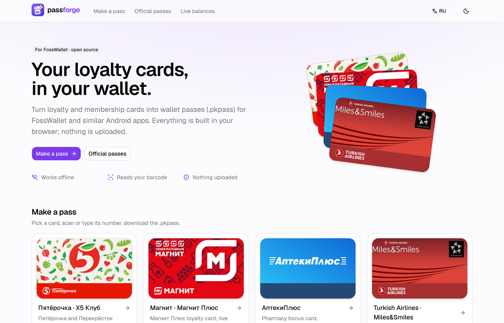
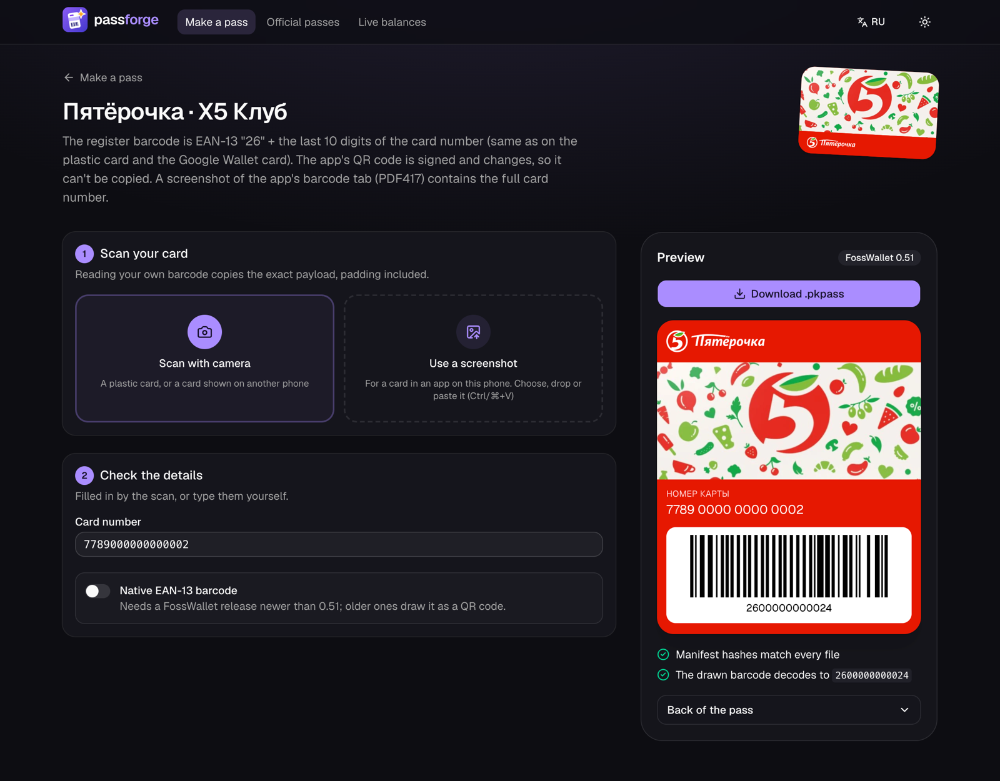

# passforge

> [!WARNING]
> **A fully vibe-coded hobby project for personal use. No guarantees of any kind.**
> Almost all of the code was written by an AI assistant (Claude) and only lightly reviewed by a human. It works for
> its author; it may not work for you, and it may break whenever a shop changes its website.
>
> - **Unofficial.** Not affiliated with, endorsed by or supported by Пятёрочка/X5, Магнит, АптекиПлюс, Спортмастер,
>   O'STIN, «Кошелёк», Turkish Airlines, Аэрофлот, Nordwind, #FARШ/PremiumBonus or FossWallet. Names and logos belong to their owners (see
>   [PROVENANCE](apps/web/public/brands/PROVENANCE.md)).
> - **Check your pass at the register** before relying on it, and keep the shop's own card or app as a fallback.
>   A pass is only as good as the number and barcode in it.
> - **Live balances log in to your shop accounts for you** and keep the sessions (encrypted) on the update server.
>   Whoever runs that server can act in those accounts, so only use a server run by someone you trust. Automated
>   access may be against a shop's terms of service, and a shop could limit or block your account; use it at your
>   own risk.
> - **No support, no warranty**, as stated in the [licence](LICENSE).

Turns Russian loyalty and membership cards into wallet passes (`.pkpass`) for
[FossWallet](https://github.com/SeineEloquenz/fosswallet) and similar Android apps.

- **Web app** (static; GitHub Pages or any web server): builds *unsigned* passes entirely in the browser for Пятёрочка (X5 Клуб),
  Магнит, АптекиПлюс, Спортмастер, O'STIN and Turkish Airlines Miles&Smiles
  (Спортмастер and O'STIN only show an expiring encrypted QR, so their passes use the plain club card number that
  the «Кошелёк» app issues for the same account). It reads the barcode from a screenshot or photo of your own card,
  and shows a preview that mimics FossWallet's layout. It also guides you to the hidden **official** passes of
  #FARШ (PremiumBonus), Аэрофлот Бонус, Surf Coffee and NORDWIND КЛУБ.
- **Update server** (self-hosted, optional): a PassKit web service that keeps **live balances** on passes for invited
  users (Authentik group): Пятёрочка (X5 Клуб) and Магнит.

Unsigned passes work in FossWallet; Apple Wallet rejects them (out of scope).

<p align="center">
  
  
</p>

## Layout

```
packages/core   pass.json builders per card, EAN-13/Luhn, unsigned pkpass zip + manifest (browser + Node)
apps/web        Vite + React + Tailwind + shadcn/ui static app (canvas artwork, zxing-wasm, OIDC PKCE, guides)
apps/server     Node 24 HTTP server (runs the .ts sources directly): PassKit endpoints, JSON API, refresh scheduler
```

## Develop

```bash
pnpm install
pnpm dev          # http://localhost:5173/passforge/
pnpm test         # node:test, core + server
pnpm typecheck
```

Live features appear only when `VITE_OIDC_ISSUER`, `VITE_OIDC_CLIENT_ID` and `VITE_SERVER_URL` are set at build time.

## FossWallet notes that shape the passes

- Store card: 38dp header (logo ≤ 40% width), then a 150dp full-width center-cropped strip (≈2.2–2.5:1), then
  secondary + auxiliary fields in one row, then the barcode.
- EAN-13 cards ship as **native EAN-13**, which needs FossWallet v0.52.0+ (v0.51.0 drew it as a QR code). Code128 with
  the same digits is not a substitute: a Пятёрочка till rejected it as an unknown product.
- Updates: FossWallet polls `GET {webServiceURL}/v1/passes/{type}/{serial}` (default every hour, HTTPS only) with
  `If-Modified-Since`; a field with `changeMessage` notifies on change.

## Deployment

### 1. Authentik

Create an **OAuth2/OpenID provider** with client type **public**, redirect URI = the web app URL
(e.g. `https://<user>.github.io/passforge/`), scopes `openid profile`, signing key set (RS256). Make sure the
access token carries `groups` (the default "profile" scope mapping does; otherwise the server asks userinfo). Create a
group (default name `passforge`) and add the people allowed to use live cards. A longer access-token validity
(e.g. 1 hour) saves re-logins; when it expires the app simply signs in again.

### 2. Web app (GitHub Pages)

Settings → Pages → Source: **GitHub Actions**. Add repository **variables** `OIDC_ISSUER`, `OIDC_CLIENT_ID`,
`SERVER_URL` (leave them unset for an offline-only site). Pushing to `main` runs `.github/workflows/pages.yml`.

### 3. Update server

```bash
cp .env.example .env    # fill in; ENCRYPTION_KEY: openssl rand -base64 32
docker compose up -d --build
```

`compose.yaml` runs the server and Caddy (automatic HTTPS for `DOMAIN`). Data (SQLite, one AES-256-GCM blob per
pass holding the pass token, the shop's refresh token and card data) lives in the `data` volume. Back up `.env`
(the key) together with the volume.

**Some Russian shops sit behind QRATOR and challenge requests by source network.** In practice (Nov 2026), X5 and
Magnit answered a US VPS and a Russian home connection normally, while АптекиПлюс challenged both (see below). If a
shop's refreshes fail with an HTML error page, move the outbound traffic to another network. Two options, no code
changes:

- **Egress proxy** (keep everything on the VPS): run a small HTTP proxy (e.g. tinyproxy) on the homelab, reachable
  over Tailscale, and set `NODE_USE_ENV_PROXY=1` and `HTTPS_PROXY=http://<homelab>.<tailnet>.ts.net:8888` in `.env`.
- **Server at home**: run the `server` service on the homelab (`docker compose up -d server`, publish 8080 on the
  tailnet only), and on the VPS run only Caddy with `UPSTREAM=<homelab>.<tailnet>.ts.net:8080`. The VPS needs
  Tailscale on the host (or a tailscale sidecar).

### 3b. Host that already runs Caddy (one domain for the web app and the server)

This is how passforge.abounegm.com runs. Put `.env` in `~/passforge` on the host (with `SERVER_PORT` and `DOMAIN`),
add the site block from `deploy/Caddyfile.host` to the host's Caddyfile, then deploy from a checkout:

```bash
VITE_OIDC_ISSUER=https://auth.example.com/application/o/passforge/ VITE_OIDC_CLIENT_ID=... \
VITE_SERVER_URL=https://passforge.example.com sh deploy/vps.sh <ssh-host>
```

The script ships the committed source, rebuilds the server container (listening on `127.0.0.1` only) and uploads the
web build. The site block also sets security headers: a Content-Security-Policy allowing only the app's own scripts
(plus WebAssembly for the barcode reader) and network calls to itself and Authentik, a camera permission for the
site itself only, `nosniff`, HSTS and no framing. GitHub Pages can't send such headers, which is one reason to prefer
an own domain once sign-in is involved (Pages sites of one account also share an origin).

## Live cards: how sessions work

- Each live pass has a random serial and a random `authenticationToken` (32 bytes). FossWallet polls the server, which
  answers `304` until the data changes. The server never answers `204`, so devices never need to register.
- A scheduler refreshes every pass every `REFRESH_MINUTES` (default 30): refresh the shop session, **persist the
  rotated refresh token first**, then fetch the balance. Refreshes of one pass are serialized, so a rotating token is
  never used twice.
- If the shop rejects the session, the pass flips to «Нужен вход» (with a notification) instead of going stale.
  "Sign in again" in the web app attaches a new session to the same pass.
- Logs never contain tokens, codes or phone numbers.

### Пятёрочка / X5 Клуб

Log in from passforge with your phone: the server drives X5 ID's normal login (Keycloak realm `ssox5id`, client
`x5club`). X5 then asks you either to call a free number from that phone or to enter an SMS code; passforge always
declines the marketing consent and skips the passkey offer. The server keeps the resulting x5club.ru cookies and reads
`/lk.data` (React Router single-fetch, decoded with `turbo-stream` v2) for the card number and points. The site
session lasts 7 days; after that x5club.ru re-authenticates silently through X5 ID's cookies, which the server keeps
too. Alternatively paste the `lk.data` request ("Copy as cURL (bash)").

### Магнит

Magnit's login asks for a captcha, so it happens on magnit.ru: sign in there and paste the
`webgate/v3/user/balance` request ("Copy as cURL (bash)"). The server keeps the cookies plus the browser's
`x-device-*`/`x-app-*` headers (the session is tied to the device id) and reads `/webgate/v1/user/totp` (its
`identifier` is the card number) and `/webgate/v3/user/balance`. Group-IB anti-fraud headers (`x-gib-*`) are dropped.

### АптекиПлюс (not available live)

QRATOR serves its JavaScript challenge to the API from datacenter and home IPs (tested from a US VPS and a Russian
home connection; only a large corporate network got through), so the provider is not registered. Its code is kept:
refresh `POST https://aptekiplus.ru/api/v1/auth/user/token/refresh` (rotating token), balance
`GET /api/v1/mindbox/user-data`. Re-enable it in `providers.ts` if the fetcher runs on a network the API accepts.

### Adding a shop

Implement `Provider` in `apps/server/src/providers.ts` (`fromPaste`, `sync`, `pass`, optionally
`startLogin`/`continueLogin` for a phone login run by the server; `web.ts` has a cookie jar and a "Copy as cURL"
parser), a pass builder in `packages/core/src/cards.ts`, and artwork in `apps/web/src/art.ts`.

## Possible future improvements

- **Aeroflot miles on the official pass:** the balance is already inside Aeroflot's pass (localization string
  `LoyaltyMiles_value`) but no field shows it. The server could proxy the official pass and add a field.
- **Live АптекиПлюс:** needs the fetcher on a network QRATOR accepts (`HTTPS_PROXY`), or an API arrangement with
  АптекиПлюс. The provider code is kept.
- **X5:** let users pick SMS when X5 offers the call (the page has «Войти через SMS»); watch whether the silent
  re-login after the 7-day site session keeps working.
- **Magnit:** a login inside passforge is blocked by its captcha; if Magnit ever enforces its anti-fraud headers,
  live updates stop and the provider should say so clearly.
- **Health notifications for the owner:** today a dead session shows «Нужен вход» on the pass; an admin view or a
  message when a shop starts failing for everyone would catch upstream changes sooner.
- **Miles&Smiles:** strip art for tiers other than Classic, and the other tier codes.
- **Backups** of the server's data volume together with `.env` (the encryption key).
- **More shops:** a `Provider` plus a pass builder and artwork (see "Adding a shop").
- **Before publishing:** choose a licence (MIT is a placeholder) and fill the two missing source URLs in
  `PROVENANCE.md`.

## Brand assets

See [`apps/web/public/brands/PROVENANCE.md`](apps/web/public/brands/PROVENANCE.md) (sources, licence status,
takedown). Never commit photos of a personal card or anything with personal data. Sample data in code and tests is
fake (Luhn/EAN-valid where real cards are).
